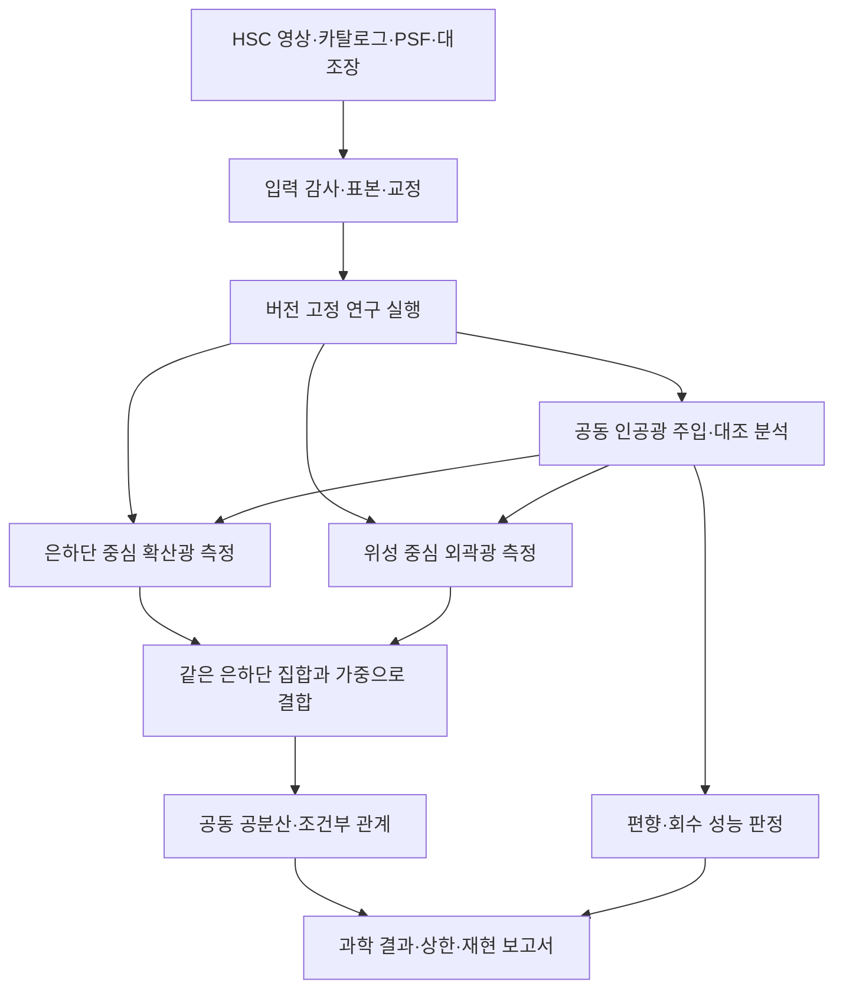

# Astrispex 연구 도구 설계: ICL–위성은하 공동 분석

작성: 2026-10-13 (Asia/Seoul)<br>
상태: **설계안 / 신규 공동 분석 기능 미구현**<br>
과학 기준: [장기 과학 연구계획](science_research_plan.md)

상위 제품 설계: [분석 목적 기반 파이프라인](../../docs/science_workflow_designer.md).
사용자의 추가 지시에 따라 본 공동 분석은 범용 도구의 과학 recipe로 둔다.
목적 해석·자료 감사·DAG·재개·결과 계약은 상위 설계를 따르고, 아래에는 이
연구에 필요한 두 갈래 측정·공동 검증·공분산 요구사항을 보존한다. 공통 runner와
registry를 중복 구현하지 않는다.

사용자가 지칭한 `astrispex`를 이 설계의 임시 명칭으로 사용한다. 기존
Astrafex/OGFinder 기능인지 별도 프로그램인지 확인 전이므로 제품명 변경이나
별도 저장소 생성은 하지 않는다. 분석 엔진은 UI와 분리하고, 현재 확인한
OGFinder 구조를 이용하는 Desktop 연결을 우선안으로 둔다. 별도 제품이어도
동일한 파일 계약과 CLI를 통해 연결할 수 있도록 한다.

## 1. 제품 목적과 첫 버전의 경계

연구자는 표본을 선택하고, 은하단 확산광과 위성 외곽광을 측정한 뒤, 관측 편향을
검증하면서 두 측정의 관계를 비교한다. 결과의 각 점에서 원본 영상·마스크·참여
대상·가중·교정·검증 기록으로 돌아갈 수 있어야 한다.

첫 버전은 HSC 영상·카탈로그 입력, CPU 실행, 동일 은하단 가중 공동 프로파일,
주입/회수와 공동 공분산, 재현 보고서를 제공한다. 원본 다운로드는 성공했던
기존 스크립트를 연결한다. 자동 BCG–ICL 물리 분리, GPU 학습, 새 렌즈 측정,
DES 혼합 스택은 첫 버전의 필수 범위에 포함하지 않는다.

## 2. 연구자가 보는 작업 흐름

| 화면 | 연구자의 결정 | 보여줄 내용 |
|---|---|---|
| 연구·자료 | 연구 실행 선택, 입력 연결 | 목표와 확보 수, 교정 준비 상태, 이전 실행과 차이 |
| 표본 | 멤버십·질량·색·적색편이·중심 거리 조건 | 선택 전후 분포, 누락 및 탈락 이유, 실제 사용 은하단·위성 수 |
| 영상 검토 | 목표·이웃·별 마스크와 배경 검토 | 원본/모형/잔차, ICL용·위성용 마스크 전환, PSF·유효 면적 |
| 두 스택 | 표본·반경·물리 단위·가중 고정 | 두 프로파일, 차이, 2D 스택, 반경별 참여 표본 |
| 검증 | 주입 범위·대조군·민감도 선택 | 회수 편향, 검출률, 가짜 관계, PSF/배경/마스크 변화 효과 |
| 공동 관계 | 사전 정의한 집단 비교 또는 오차 포함 관계 모형 | 조건부 효과·불확실성·상한, 공분산과 대조 결과 |
| 내보내기 | 결과와 재현 설정 저장 | 그림·표·방법 요약·입력 계보·검증 상태 |

실행 중 UI는 진행률·현재 단계·실패 원인과 재개 지점을 보여준다. 중단은 완료한
대상까지 저장하는 정상 종료이며 다른 작업을 종료하지 않는다. 설정을 바꾸면
기존 실행에 덮어쓰지 않고 파생 실행을 만든다. 자료·진단 내보내기는 검증 전에도
가능하지만 미검증 결과에는 그 상태를 유지한다.

초기 화면은 기존 DS9 영상 표시와 표본 표, 프로파일 창을 사용한다. 화면에
코드 경로나 해시를 기본으로 나열하지 않고 결과 추적용 상세 보기에서 제공한다.

## 3. 처리 구조



G에서 D/E로 들어가는 것은 별도의 합성 실행이다. 관측 원본을 수정하지 않는다.
관측과 합성 데이터는 같은 측정 경로를 사용하되 실행 유형으로 구별한다.

## 4. 기존 기능 재사용과 신규 책임

아래 재사용 판단은 코드·manifest 확인에 따른 설계이며 관측 성능 인증이 아니다.

| 현재 코드 | 재사용 후보 | 필요한 확장 또는 제한 |
|---|---|---|
| `icl/pilot.py` | 영점 변환, 원본 고리 측정, 면적 보존 워프, cluster/random 요약 | 위성 단위 입력·두 갈래 공동 재표집은 신규 |
| `icl/wgl.py` | kpc 좌표, 참여 대상 기록, 스택 메타데이터 | 기존 메타데이터 checklist만으로 과학 검증 완료 처리 금지 |
| `plugins/stacking/` | 위치 기반 우표 정렬·조합 및 UI 연결 패턴 | 위성 단위 bootstrap을 은하단 독립 오차로 사용 금지; 국소 배경 기본값 검증 |
| `plugins/icl/` | ICL 메뉴·설정·영상 진단 | 공동 연구를 실행하는 별도 단계와 결과 연결 필요 |
| `hsc_debug/download_pilot.py` 및 기존 wrapper | 전송·재개 | 새 인증 흐름을 만들지 않고 입력 완료 기록을 읽음 |
| `hsc_debug/hsc_quality.py` | FITS/WCS/마스크·면적 감사 | PSF/검출 완전도/공동 신호 검증을 대신하지 않음 |

제안 코드 위치는 `icl/joint/`와 `plugins/icl_joint/`이다. 이 디렉터리는 아직
생성하거나 구현하지 않았다. Desktop plugin은 Tcl/manifest와 얇은 CLI adapter만
담고, 계산은 UI를 import하지 않는 엔진이 맡는다. 기존 Desktop Python 코드를
Web/Core에 복사하지 않으며 제품 경계와 라이선스는 기존 정책을 따른다.

| 제안 모듈 | 책임 |
|---|---|
| `contracts.py` | 입력 스키마·단위·ID·검증 상태 |
| `ingest.py`, `selection.py` | 원본 계보, 카탈로그 대응, 표본/멤버십/통제 가중 |
| `calibration.py`, `psf.py` | 광도·소광·밴드·해상도 처리 및 오차 |
| `scene.py`, `masks.py` | BCG·확산광·위성·이웃 모형, 목적별 마스크 |
| `diffuse.py`, `satellites.py` | 은하단 및 위성 중심 프로파일 |
| `controls.py`, `injection.py` | survey/은하단 내 대조 위치, 공동 주입·회수 |
| `aggregate.py`, `covariance.py` | 은하단별 평균, 공동 재표집·공분산 |
| `relation.py` | 집단별 차이·측정오차와 선택을 포함한 관계 추정 |
| `runner.py`, `report.py` | 단계 의존성·재개·상태·재현 보고서 |

## 5. 데이터 계약

모든 테이블은 `schema_version`, 명시적 단위, 입력 ID와 출처를 갖는다. 미확인
값은 null과 사유를 저장하며 0으로 채우지 않는다. 예측·대체값은 관측값과
다른 열로 둔다. 큰 픽셀 배열은 FITS, 표는 TSV 또는 검증된 열 형식,
설정·계보·상태는 JSON으로 시작한다.

| 객체 | 필수 내용 |
|---|---|
| `Cluster` | 안정적인 cluster ID, BCG 중심과 출처, z_cl/z_spec, 선택층, richness, sky region |
| `ExposureProduct` | 제품 ID/릴리스/경로/기록 해시, HDU, WCS, 영점, filter, 마스크 bit 정의, variance, 교정 출처 |
| `Satellite` | source ID와 cluster ID의 쌍, 좌표, 멤버십 근거·확률의 출처, R_kpc, 측광/질량/색 및 품질·오차 |
| `PSFRecord` | 위치·밴드·제품 대응, 모형/날개/규격화·검증 범위 |
| `ControlSet` | survey/cluster-local 구분, 대응 대상, 선택 조건·seed·배제 영역 |
| `MeasurementSpec` | R/r 반경, 단위, 광도 정규화, PSF·배경·마스크 버전, BCG/ICL 정의, 가중·대상 |
| `Profile` | 대상·실행 ID, 갈래, 반경, flux/SB, 분산·공분산 참조, 면적, 참여 ID·가중, 제외 이유 |
| `ValidationEvidence` | 검증 종류, 적용 표본/반경/설정, 수치 기준·관측값·판정·출처 |

같은 은하가 여러 cluster 후보에 대응할 수 있으므로 source ID와 관계 ID를
구별한다. 중복 사용 또는 확률 배분 정책을 고정하고 공분산에 반영한다.
반경별 표본 누락은 유효 면적과 함께 보고하며 두 갈래의 표본 차이를 감춘 채
상관을 계산하지 않는다.

## 6. 측정 엔진의 핵심 계약

### 6.1 분리된 마스크와 공유된 계보

공통 검출 목록·결함·밝은 별 정보에서 두 마스크를 만든다. ICL 갈래는 위성을
가리고, 위성 갈래는 현재 목표를 보존한다. `diffuse_mask_id`와
`satellite_mask_id`를 별도로 기록한다. 같은 마스크를 두 목적에 그대로 쓰지 않는다.
수동 편집은 새 mask 버전과 편집 영역·사유로 남겨 동일 실행을 재현한다.

### 6.2 하늘 배경과 천체 확산광

국소 영상의 모형을 `위성 + BCG/확산광 + 이웃 + 관측 하늘 잔차`로 구분하고
PSF 및 픽셀화 효과를 포함한다. 유연한 배경 모형이 위성 외곽을 흡수할 수
있으므로 배경 차수·영역을 주입/회수로 제한한다. 모든 성분이 영상 하나에서
독립적으로 식별 가능하다고 가정하지 않으며 대체 모형 차이를 오차에 반영한다.
코애드 주입만으로 상류 sky 처리 손실이 검증됐다고 보고하지 않는다.

### 6.3 정렬과 평균

고유 kpc 좌표와 SB/광도 면적 단위를 명시한다. flux 합산과 SB 보간의 보존
조건을 구별한다. 원본 고리 추정량과 워프한 영상 결과를 대조하며 마스크 누출,
보간·PSF가 만든 상관 잡음을 추적한다. deconvolution은 기본 과학 경로로 쓰지 않는다.

위성 프로파일을 은하단 안에서 통제 가중으로 평균한 뒤 은하단 평균을 낸다.
richness가 큰 은하단이 위성 수만으로 주 결과를 지배하지 않게 한다. 동시에
가중이 나타내는 모집단과 유효 은하단 수를 출력한다. 광도·크기 정규화가
연구하려는 외곽 차이를 지우는지 확인하고 정규화 전 결과도 보관한다.

### 6.4 공동 관계와 불확실성

각 은하단의 확산광 지표 D와 위성 외곽 잔차 S를 같은 재표집에서 재계산하여
`Cov(D,D)`, `Cov(S,S)`, `Cov(D,S)`를 저장한다. 개별 D/S가 낮은 신호대잡음이면
사전 집단별 비교 또는 잠재값을 둔 모형을 사용하고 잡음이 큰 비율을 직접
회귀하지 않는다. 단 두 개의 전체 평균으로 상관을 주장하지 않는다.

통제 변수는 z, 위성 질량·색, R, 은하단 richness 또는 검증된 질량, BCG 특성,
깊이·PSF·마스크다. 변수 수와 bin 수는 유효 표본에 맞춰 예비 분석에서 제한한다.
richness의 검출 편향과 현재 별질량 선택의 물리적 의미를 검토한다. 주입에서
유도되는 거짓 관계와 신호 회수율을 함께 출력한다.

jackknife 영역 수에 비해 차원이 큰 공분산은 바로 역행렬로 쓰지 않는다.
차원 축소나 사전 정의 규제를 검증하고, 유효 표본이 부족하면 진단 상태로 남긴다.
후속 약중력 분석을 붙일 때는 동일 은하단 ID·전단 카탈로그·가중과 질량 오차를
새 입력 계약으로 추가한다.

## 7. 실행 상태와 저장 구조

작업 상태는 `planned → ready → running → completed`와 `failed/interrupted`로
관리한다. 과학 상태는 별개로 `unvalidated → diagnostic → validated`이며
반경·측정량·주장별로 저장한다. 프로그램 정상 종료는 과학 검증 통과가 아니다.
`science_measurement`는 기존 호환 출력이고 주장별 증거가 충족될 때만 true다.

실행 루트 예시는 `/gpfs/kjhan/Astrafek/data/icl_satellite_joint/<run_id>/`이며
실제 실행 시 새 디렉터리를 만든다. 다음 구조는 아직 생성하지 않은 계약이다.

```text
<run_id>/
  config.json             # 입력 참조, 분석 정의, seed, 자원 상한
  provenance.json         # 코드 버전/dirty 변경 스냅샷 참조, 환경, 입력 계보
  selection.tsv           # 선택·탈락 근거, 통제 가중
  state.json              # 원자적으로 갱신되는 단계별 상태
  clusters/<id>/          # 대상별 프로파일·마스크·진단
  controls/               # 대조 표본 및 대응 관계
  injections/             # truth와 동일 측정 경로의 회수 결과
  stacks/                 # 두 갈래 프로파일 및 선택적 2D 영상
  covariance/             # 공동 재표집과 공분산
  validation/             # 기준·결과·미통과 이유
  report/                 # 그림·표·방법·재현 설정
```

재개 키는 코드·입력 제품·선택·교정·설정의 fingerprint다. 불일치하면 해당
후속 단계는 새 실행으로 계산한다. 완료 여부는 파일 존재만으로 판정하지 않고
스키마·완료 기록·입력 계보를 확인한다. 상태 파일은 임시 파일 작성 후 원자적
교체, 실행 디렉터리는 단일 writer lock을 사용한다. 실패 대상은 조용히 제외하지
않고 부분 완료 상태와 선택 영향을 보고한다.

## 8. CPU 실행과 운영

대용량 처리는 `lageunha`에서 수행한다. 기본은 worker 1개·수치 라이브러리
thread 1개이며 첫 실제 작업의 최대 메모리와 I/O를 측정한 뒤 상한 내에서
늘린다. FITS 전체를 800개 동시에 메모리에 올리지 않고 은하단별로 읽는다.
모든 우표 cube 저장은 선택 사항이고 기본 산출물은 누적 통계·프로파일이다.

UI는 계산과 분리된 프로세스의 상태 파일을 읽는다. 원격 실행은 연구별 worker
한 개가 상태를 기록하고 UI는 갱신 주기를 최소 60초로 둔다. 인증정보와 셸
환경 전체를 기록하지 않는다. 이미 받은 파일을 분석할 때 HSC 로그인을 요구하지
않으며 추가 다운로드가 필요할 때 기존 downloader를 통해 사용자가 실행한다.
syntax 로그인 노드에 장시간 분석·상주 polling 프로세스를 만들지 않는다.

제안 CLI 단계명은 `audit`, `select`, `prepare`, `measure-diffuse`,
`measure-satellites`, `inject-recover`, `aggregate`, `relate`, `report`이다.
이는 인터페이스 설계이며 현재 실행 가능한 명령으로 안내하지 않는다.

## 9. 구현 순서와 검증

| 순서 | 구현 범위 | 수용 기준 |
|---|---|---|
| M0 | 스키마·입력 감사·단계 실행기 | 누락 입력과 재개 불일치 검출, 기존 FITS/다운로드 재사용 |
| M1 | 30–50개 예비 표본의 두 프로파일 | 목표 보존·이웃 제외, 단위/PSF/면적 검증, 각 점의 입력 추적 |
| M2 | 공동 주입/회수·대조·공분산 | 무상관에서 인공 관계 확인·제어, 알려진 신호 회수, 은하단 재표집 |
| M3 | 동일 표본 공동 스택·관계 모형 | 고정 분석 정의로 재현, 오차·선택·미통과 범위 포함 |
| M4 | Desktop 연결·보고서 | CLI와 GUI가 같은 설정·결과를 만들고 정상 중단·재개 가능 |
| M5 | 검증된 범위의 전체 표본 처리 | 체계오차·표본·공분산·검출 또는 상한을 함께 출판 가능하게 출력 |

물리 검증은 PSF로 번진 알려진 프로파일, 위치에 따른 같은 은하의 검출률,
독립 ICL/위성 진폭을 넣은 무상관 장면, 상관이 있는 장면, 마스크 확대와 배경
모형 변화, 주입 이전/이후 처리 범위의 차이를 포함한다. 통계 검증은 동일
은하단의 위성을 복제해도 독립 은하단 수가 늘지 않는지, 공동 오차가 재현되는지
확인한다. 큰 Monte Carlo와 영상 검증은 lageunha에서 수행한다.

완료 기준의 수치 허용치는 예비 분석의 오차 예산으로 정해 본 분석 전에 고정한다.
화면이나 함수의 존재를 과학 측정 성공으로 표시하지 않는다. 이번 변경은 연구
계획·도구 설계 문서 등록이며 계산 코드 구현·새 분석 실행은 포함하지 않는다.
