# 분야별 과학 파이프라인과 연구 세션

2026-10-13: Desktop과 Web에서 같은 11개 선언적 순서도를 사용한다. 단계 도구 연결 및 수동 검토를 제공하며, 모든 분야의 과학 분석이 자동 완성된 상태는 아니다.

## 사용 방법

- Desktop: 본창 분석 패널의 분석 목적 선택. Measure → Workflows에서도 같은 패널로 연결한다. 별도 파이프라인 팝업은 만들지 않는다.
- Web: 본창 왼쪽 아래 분석 메뉴에서 분야를 클릭하면 왼쪽 위 PIPELINE · 분석 단계 목록이 해당 분야로 바뀐다. 단계 설명·메모·도구 열기·저장은 중앙 분석 영역에 표시한다. Classic과 Workspace에서도 같은 컴포넌트를 사용한다.
- 분야를 고르면 입력, 최종 산출물, 분석 순서도가 본창에 표시된다. 단계를 선택해 도구를 열고 결과·메모를 남긴다.
- 실행 adapter가 없는 단계는 안내·검토로 표시한다. `reviewed`는 사용자의 검토 기록이며 과학 검증 통과가 아니다.

## 중간 저장과 복원

- Desktop의 현재 단계까지 저장: 선택 단계·설정·메모·도구 실행 기록·현재 카탈로그와 등록 산출물을 새 스냅샷에 복사한다. recorder가 열거하지 않은 결과는 산출물 파일 추가로 연결한다. 디렉터리를 재귀 복사하지 않는다.
- 산출물의 SHA-256을 확인하고 저장 도중 바뀐 파일은 거절한다. 재개 시 원본 스냅샷을 수정하지 않는 작업 사본을 만든다. 원본 영상은 외부 경로·크기·수정시간 참조이며 자동 백업되지 않는다.
- Desktop의 저장 세션 열기: session.json을 선택한다. 진행·설정·표·산출물을 복원한 뒤 영상·도구별 내부 작업 자료를 다시 연결한다. 입력 변경/누락 또는 저장 설정 변경은 needs_review로 표시한다. 계산 프로세스 자체의 메모리는 복원하지 않는다.
- Web의 현재 단계까지 저장: 계정 세션에 진행을 저장하고 정확한 save 이벤트까지의 완료 산출물을 ZIP으로 내려받는다. 파일 누락·변조·복사 중 변동은 성공으로 표시하지 않는다. 브라우저 다운로드 완료도 확인한다.
- Web의 저장 세션 열기: Session에서 계정의 세션과 저장 지점을 골라 Restore한다. 서버에 남은 입력·작업 산출물로 이어간다. 서버 보관 기한은 별도 정책이며 ZIP만으로 새 서버에 모든 작업을 자동 복원하는 신규 import 기능은 이번 범위에 없다.
- 진행 중 계산은 완료로 승격하지 않는다. Web/일부 Desktop 도구의 내부 상태·지원되지 않는 분광/시간영역 adapter는 추가 연결이 필요하다.

## 단계 실행과 결과 추적

- Web의 중앙 단계 설명에서 이 단계 실행을 누르면 연결된 분석기를 현재 설정으로 실행한다. 실제 입력·설정·실행 정책은 기존 실행기가 검사한다. adapter가 없거나 입력이 부족하면 실행되지 않는다.
- 파이프라인은 대기·실행 중·계산 완료·실패·취소 상태와 작업 ID를 표시한다. 완료 산출물은 단계 설명 아래에 연결된다. 계산 완료(`succeeded`) 후 잔차·품질을 검토해 다음 단계로 진행한다.
- Web 저장에는 단계별 작업 ID가 포함되며, 서버가 계정·같은 기록 세션·단계에 맞는 분석기인지 확인한다. 실행 결과는 서버 기록을 기준으로 삼는다. 재개 시 서버에 남은 실행 중 작업은 기존 작업을 관찰하며 중복 실행하지 않는다. 작업이 삭제됐다면 재검토가 필요하다.
- Desktop은 순서도에서 직접 실행한 도구의 기록이 있는 경우 실행 상태를 자동 연결한다. 설정 창만 연 경우는 `opened`이며 계산 완료로 표시하지 않는다. 기록되지 않은 도구 내부 동작은 수동 검토가 필요하다.
- Desktop에서 실행 중 저장한 상태를 새 프로그램에서 열면 `needs_review`로 바뀐다. 프로세스 메모리를 복원하지 않으므로 입력을 다시 연결하고 해당 계산을 재실행한다.
- 앞 단계 재실행과 설정 변경은 기존 완료·검토 결과를 재검토 상태로 바꾼다. 실패·취소된 계산은 재실행한 뒤 검토한다. 모든 상태에서 자동 과학 검증 완료를 선언하지 않는다.

## 파이프라인 목록

### 구상성단 · 별 측광

입력: 교정된 성단 영상, 오차/마스크, 영점; CMD는 두 밴드 이상.

최종 산출물: 별 측광 표, 오차·완전도, 잔차 영상, 가능한 경우 CMD

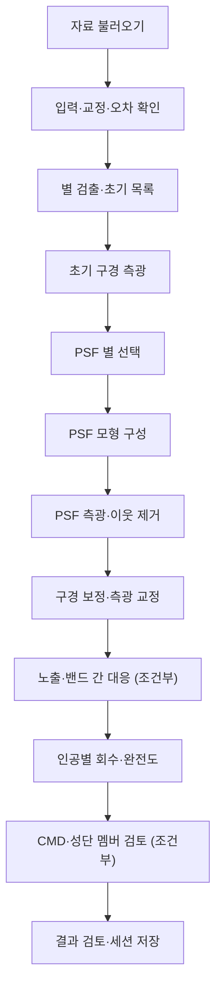

- **자료 불러오기**: 교정된 성단 영상, 오차/마스크, 영점; CMD는 두 밴드 이상.
- **입력·교정·오차 확인**: 단위, 영점, WCS, variance, 마스크, 포화, 처리 이력을 확인합니다. 원시 자료는 기구별 교정이 필요합니다.
- **별 검출·초기 목록**: 혼잡도와 포화 별을 확인하고 초기 별 목록을 만듭니다.
- **초기 구경 측광**: PSF 별 선택에 필요한 초기 등급과 하늘 추정값을 확인합니다.
- **PSF 별 선택**: 고립된 별과 이웃 영향을 검토합니다.
- **PSF 모형 구성**: 공간 변화와 PSF 잔차를 확인합니다.
- **PSF 측광·이웃 제거**: 혼잡한 별을 적합하고 잔차 재검출을 검토합니다.
- **구경 보정·측광 교정**: 구경 보정 후 영점·색항·오차를 확인합니다. 영점이 없으면 기기등급으로 표시합니다.
- **노출·밴드 간 대응**: 같은 별을 대응합니다. 단일 영상이면 생략 사유를 기록합니다.
- **인공별 회수·완전도**: 등급과 중심 거리별로 최종 품질 컷까지 회수합니다.
- **CMD·성단 멤버 검토**: 두 밴드 이상일 때 CMD를 생성합니다. 검출 별 전체를 멤버로 확정하지 않습니다.
- **결과 검토·세션 저장**: 측정 표·오차·잔차·검증 결과를 확인하고 산출물을 연결한 뒤 연구 세션을 저장합니다. 검토 완료는 과학 검증 통과와 다릅니다.

### 산개성단 · 측광과 멤버

입력: 교정된 성단 영상과 밴드 정보; 멤버 판정에는 고유운동·시차 등 추가 자료.

최종 산출물: 측광 표, CMD, 근거를 명시한 멤버 후보 및 완전도

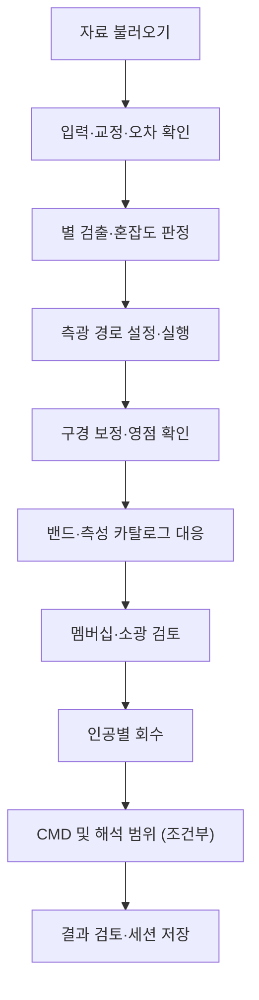

- **자료 불러오기**: 교정된 성단 영상과 밴드 정보; 멤버 판정에는 고유운동·시차 등 추가 자료.
- **입력·교정·오차 확인**: 단위, 영점, WCS, variance, 마스크, 포화, 처리 이력을 확인합니다. 원시 자료는 기구별 교정이 필요합니다.
- **별 검출·혼잡도 판정**: 혼잡도에 따라 구경 또는 PSF 측광 경로를 선택합니다.
- **측광 경로 설정·실행**: 분리된 별은 구경 측광, 혼잡한 영역은 PSF 적합을 선택하고 근거를 기록합니다.
- **구경 보정·영점 확인**: 측광계와 색항, 노출 간 교정을 확인합니다.
- **밴드·측성 카탈로그 대응**: 다중 밴드 또는 고유운동·시차 자료를 대응하고 선택함수를 기록합니다.
- **멤버십·소광 검토**: 관측 오차와 전경·배경을 포함한 멤버 모형이 필요합니다. 은하단 red-sequence 기능으로 대체하지 않습니다.
- **인공별 회수**: 등급·위치별 검출 및 측광 편향을 평가합니다.
- **CMD 및 해석 범위**: 나이·거리 적합은 추가 모형·소광·쌍성 가정이 있을 때 별도 수행합니다.
- **결과 검토·세션 저장**: 측정 표·오차·잔차·검증 결과를 확인하고 산출물을 연결한 뒤 연구 세션을 저장합니다. 검토 완료는 과학 검증 통과와 다릅니다.

### ICL · 은하단 확산광

입력: 확산광 보존 이력이 확인된 영상, PSF·마스크·은하단 중심·적색편이 및 대조장.

최종 산출물: 정의를 명시한 BCG+확산광/ICL 프로파일, 오차·마스크·검증 결과

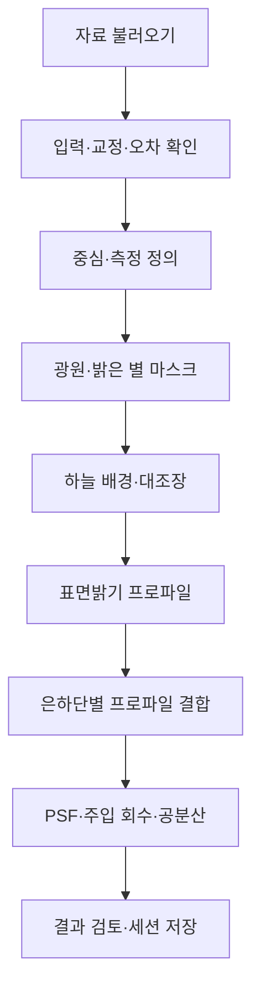

- **자료 불러오기**: 확산광 보존 이력이 확인된 영상, PSF·마스크·은하단 중심·적색편이 및 대조장.
- **입력·교정·오차 확인**: 단위, 영점, WCS, variance, 마스크, 포화, 처리 이력을 확인합니다. 원시 자료는 기구별 교정이 필요합니다.
- **중심·측정 정의**: BCG 보존/제외, 반경, 단위와 ICL 정의를 고정합니다.
- **광원·밝은 별 마스크**: BCG와 위성 처리 규칙을 구별하고 검출 누락을 평가합니다.
- **하늘 배경·대조장**: 은하단 외곽을 빈 하늘로 가정하지 않습니다. 대조장과 배경 전달을 검증합니다.
- **표면밝기 프로파일**: PSF·소광·밴드와 면적을 확인합니다.
- **은하단별 프로파일 결합**: 같은 은하단 가중, 참여 ID, 반경별 면적을 기록합니다. 스택 입력 manifest를 먼저 준비합니다.
- **PSF·주입 회수·공분산**: 배경/마스크 변화와 은하단 단위 공분산을 검증합니다.
- **결과 검토·세션 저장**: 측정 표·오차·잔차·검증 결과를 확인하고 산출물을 연결한 뒤 연구 세션을 저장합니다. 검토 완료는 과학 검증 통과와 다릅니다.

### LSBG · 탐색과 구조

입력: 넓은 시야 또는 대상 영상, PSF·영점·마스크와 sky 처리 이력.

최종 산출물: LSBG 후보 표, 각크기·표면밝기·오차, 컷아웃 및 선택 완전도

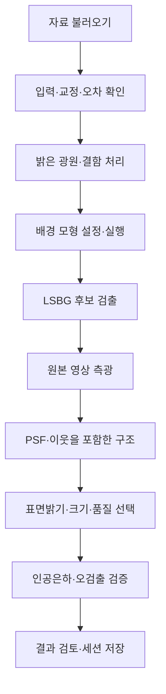

- **자료 불러오기**: 넓은 시야 또는 대상 영상, PSF·영점·마스크와 sky 처리 이력.
- **입력·교정·오차 확인**: 단위, 영점, WCS, variance, 마스크, 포화, 처리 이력을 확인합니다. 원시 자료는 기구별 교정이 필요합니다.
- **밝은 광원·결함 처리**: 확장광원을 보존하며 별 날개와 결함을 가립니다.
- **배경 모형 설정·실행**: 모형이 LSBG를 지우는 효과를 인공은하로 확인합니다.
- **LSBG 후보 검출**: 설정한 배경 처리와 크기 범위를 확인하고 검출합니다.
- **원본 영상 측광**: 검출용 평활 영상과 측광용 원본을 구별합니다.
- **PSF·이웃을 포함한 구조**: Sérsic 적합과 잔차·퇴화·실패를 검토합니다.
- **표면밝기·크기·품질 선택**: 거리 없이 물리 크기를 확정하지 않습니다.
- **인공은하·오검출 검증**: 검출부터 최종 선택까지 회수하고 순도는 독립 근거로 평가합니다.
- **결과 검토·세션 저장**: 측정 표·오차·잔차·검증 결과를 확인하고 산출물을 연결한 뒤 연구 세션을 저장합니다. 검토 완료는 과학 검증 통과와 다릅니다.

### Stellar spectrum · 항성 분광

입력: 1D 스펙트럼 또는 교정된 2D/IFU, 파장·flux·오차와 분해능; 대응 대상 목록.

최종 산출물: 흡수선·시선속도 등 검증된 측정, 스펙트럼·잔차 및 오차

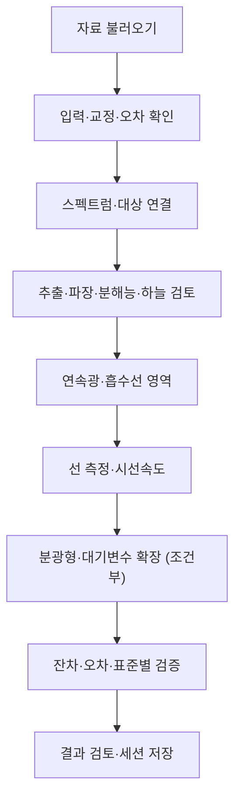

- **자료 불러오기**: 1D 스펙트럼 또는 교정된 2D/IFU, 파장·flux·오차와 분해능; 대응 대상 목록.
- **입력·교정·오차 확인**: 단위, 영점, WCS, variance, 마스크, 포화, 처리 이력을 확인합니다. 원시 자료는 기구별 교정이 필요합니다.
- **스펙트럼·대상 연결**: 1D/2D/IFU와 파장·flux·오차 단위를 설정하고 대상 catalog와 연결합니다.
- **추출·파장·분해능·하늘 검토**: 2D/IFU는 추출 영역과 sky, 1D는 기존 교정을 확인합니다. 파장 air/vacuum, 관측/휴지계와 중복 보정을 확인합니다.
- **연속광·흡수선 영역**: telluric·결함 영역, 연속광과 기기 분해능을 확인합니다.
- **선 측정·시선속도**: 원하는 측정에 맞는 설정·템플릿과 기준계를 확인합니다.
- **분광형·대기변수 확장**: 온도 letter 도구에는 검증된 사용자 모형이 필요합니다. Teff/logg/금속도 정밀 적합을 대신하지 않습니다.
- **잔차·오차·표준별 검증**: 중심속도 보정은 시간·관측소 정보가 있을 때만 수행하며 회수 실험·대조 스펙트럼을 사용합니다.
- **결과 검토·세션 저장**: 측정 표·오차·잔차·검증 결과를 확인하고 산출물을 연결한 뒤 연구 세션을 저장합니다. 검토 완료는 과학 검증 통과와 다릅니다.

### AGN spectrum · 활동은하핵 분광

입력: 교정된 스펙트럼과 오차·분해능·적색편이 근거, 관측 파장 범위.

최종 산출물: 연속광·방출선 측정, 분해 모형과 불확실성; 지원되는 범위의 진단

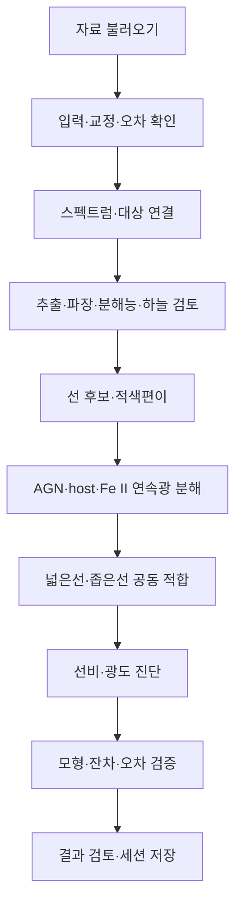

- **자료 불러오기**: 교정된 스펙트럼과 오차·분해능·적색편이 근거, 관측 파장 범위.
- **입력·교정·오차 확인**: 단위, 영점, WCS, variance, 마스크, 포화, 처리 이력을 확인합니다. 원시 자료는 기구별 교정이 필요합니다.
- **스펙트럼·대상 연결**: 1D/2D/IFU와 파장·flux·오차 단위를 설정하고 대상 catalog와 연결합니다.
- **추출·파장·분해능·하늘 검토**: 2D/IFU는 추출 영역과 sky, 1D는 기존 교정을 확인합니다. 파장 air/vacuum, 관측/휴지계와 중복 보정을 확인합니다.
- **선 후보·적색편이**: 넓은 선만으로 정한 적색편이를 좁은 선 등으로 대조합니다.
- **AGN·host·Fe II 연속광 분해**: 적절한 템플릿 및 넓은/좁은 선 공동 모형이 필요합니다. 전용 adapter는 미구현입니다.
- **넓은선·좁은선 공동 적합**: 블렌딩·기기 분해능·흡수와 공분산을 포함합니다. 단순 Gaussian 결과를 전용 분해의 대체로 표시하지 않습니다.
- **선비·광도 진단**: 필요한 선의 검출/상한과 소광을 전파합니다. 블랙홀 질량은 검증된 보정관계와 광도가 있을 때만 별도 산출합니다.
- **모형·잔차·오차 검증**: 대체 연속광/성분 수와 회수 실험으로 체계오차를 확인합니다.
- **결과 검토·세션 저장**: 측정 표·오차·잔차·검증 결과를 확인하고 산출물을 연결한 뒤 연구 세션을 저장합니다. 검토 완료는 과학 검증 통과와 다릅니다.

### Galaxy spectrum · 은하 분광

입력: 교정된 은하 스펙트럼 또는 IFU와 오차·분해능·추출 구경 정보.

최종 산출물: 적색편이·선 측정·오차 및 지원되는 종족/운동학 진단

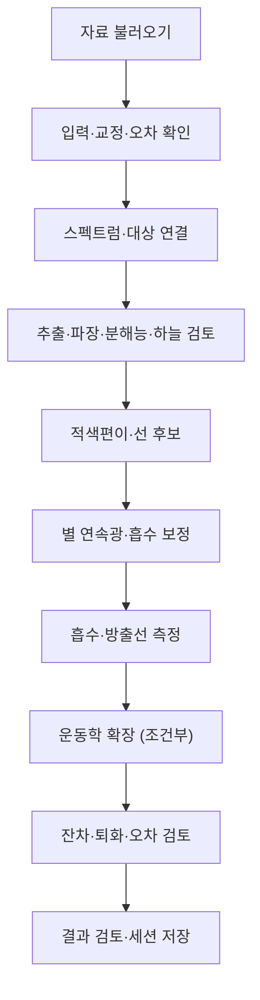

- **자료 불러오기**: 교정된 은하 스펙트럼 또는 IFU와 오차·분해능·추출 구경 정보.
- **입력·교정·오차 확인**: 단위, 영점, WCS, variance, 마스크, 포화, 처리 이력을 확인합니다. 원시 자료는 기구별 교정이 필요합니다.
- **스펙트럼·대상 연결**: 1D/2D/IFU와 파장·flux·오차 단위를 설정하고 대상 catalog와 연결합니다.
- **추출·파장·분해능·하늘 검토**: 2D/IFU는 추출 영역과 sky, 1D는 기존 교정을 확인합니다. 파장 air/vacuum, 관측/휴지계와 중복 보정을 확인합니다.
- **적색편이·선 후보**: 여러 선과 흡수 특징의 일관성을 확인합니다.
- **별 연속광·흡수 보정**: 검증된 항성종족 템플릿이 필요한 분기는 별도 준비합니다.
- **흡수·방출선 측정**: SFR은 flux 교정·거리·소광·AGN 오염 및 구경 조건을 확인한 경우에만 해석합니다.
- **운동학 확장**: 2D/IFU와 기기 분해능이 있을 때 속도/분산 지도를 검토합니다.
- **잔차·퇴화·오차 검토**: 별종족 정밀 추론과 간단한 선 기반 분류를 구별합니다.
- **결과 검토·세션 저장**: 측정 표·오차·잔차·검증 결과를 확인하고 산출물을 연결한 뒤 연구 세션을 저장합니다. 검토 완료는 과학 검증 통과와 다릅니다.

### Single galaxy · 형태와 구조

입력: 대상 은하 영상, PSF·오차·마스크·영점; 물리 크기는 거리 필요.

최종 산출물: 형태 지표, 광도 프로파일·모형·잔차, 오차 및 해석 범위

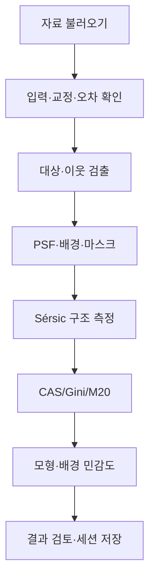

- **자료 불러오기**: 대상 은하 영상, PSF·오차·마스크·영점; 물리 크기는 거리 필요.
- **입력·교정·오차 확인**: 단위, 영점, WCS, variance, 마스크, 포화, 처리 이력을 확인합니다. 원시 자료는 기구별 교정이 필요합니다.
- **대상·이웃 검출**: 대상 은하를 선택하고 주변 천체를 식별합니다.
- **PSF·배경·마스크**: 대상 외곽을 보호하며 sky/PSF 모형과 이웃 처리를 확인합니다.
- **Sérsic 구조 측정**: 반경·축비·위치각과 잔차를 검토하고 PSF 처리 적용 여부를 확인합니다.
- **CAS/Gini/M20**: 분할 영역·중심·배경과 신호대잡음 의존성을 점검합니다.
- **모형·배경 민감도**: 해상도와 주입 실험으로 측정 편향을 평가합니다. 다성분 분해는 지원·검증 범위에 따라 별도 추가합니다.
- **결과 검토·세션 저장**: 측정 표·오차·잔차·검증 결과를 확인하고 산출물을 연결한 뒤 연구 세션을 저장합니다. 검토 완료는 과학 검증 통과와 다릅니다.

### Source extractor · 광원 검출

입력: 영상, mask/variance, pixel scale·영점과 검출 목적.

최종 산출물: 검출 목록·segmentation, 측광/위치 오차·플래그·완전도

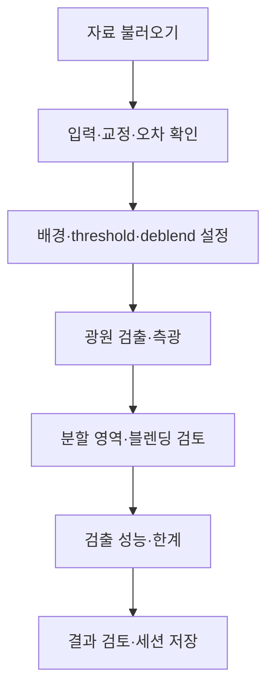

- **자료 불러오기**: 영상, mask/variance, pixel scale·영점과 검출 목적.
- **입력·교정·오차 확인**: 단위, 영점, WCS, variance, 마스크, 포화, 처리 이력을 확인합니다. 원시 자료는 기구별 교정이 필요합니다.
- **배경·threshold·deblend 설정**: 점광원/확장광원 목적과 잡음·필터를 맞춥니다.
- **광원 검출·측광**: 설정된 backend를 기록합니다. SEP 기반 추출과 외부 SExtractor 실행을 구별합니다.
- **분할 영역·블렌딩 검토**: 분할/병합·밝은 별·영상 결함을 확인합니다.
- **검출 성능·한계**: 목적에 맞는 점광원/확장광원을 넣어 검출 및 품질 컷의 회수율을 측정합니다.
- **결과 검토·세션 저장**: 측정 표·오차·잔차·검증 결과를 확인하고 산출물을 연결한 뒤 연구 세션을 저장합니다. 검토 완료는 과학 검증 통과와 다릅니다.

### 소행성 · 이동천체 탐색

입력: 여러 시점의 영상과 정확한 관측시각·관측소; 기존 영상 목록을 불러옵니다.

최종 산출물: 이동 후보·tracklet·측성/측광 표 및 가능한 범위의 궤도 제약

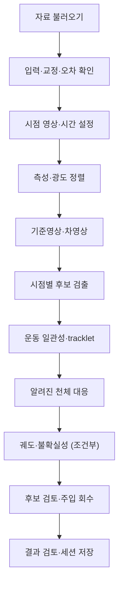

- **자료 불러오기**: 여러 시점의 영상과 정확한 관측시각·관측소; 기존 영상 목록을 불러옵니다.
- **입력·교정·오차 확인**: 단위, 영점, WCS, variance, 마스크, 포화, 처리 이력을 확인합니다. 원시 자료는 기구별 교정이 필요합니다.
- **시점 영상·시간 설정**: 노출별 시간계·관측소·필터·WCS·오차를 기록합니다.
- **측성·광도 정렬**: 정렬 오차·seeing·영점과 유효 영역을 검토합니다.
- **기준영상·차영상**: 기준영상이 새 천체 신호를 포함하는지 확인합니다. PSF와 분산을 전파합니다.
- **시점별 후보 검출**: 우주선·결함·회절선·쌍극 잔차를 제거합니다.
- **운동 일관성·tracklet**: 시간순 위치와 속도 범위·오연결률을 검토합니다.
- **알려진 천체 대응**: 관측시각·위치 오차를 포함해 알려진 천체를 대조합니다.
- **궤도·불확실성**: 짧은 관측호는 유일 궤도를 보장하지 않습니다.
- **후보 검토·주입 회수**: 이동 인공천체의 회수와 오연결을 확인합니다. 외부 관측 보고는 별도 사용자 작업입니다.
- **결과 검토·세션 저장**: 측정 표·오차·잔차·검증 결과를 확인하고 산출물을 연결한 뒤 연구 세션을 저장합니다. 검토 완료는 과학 검증 통과와 다릅니다.

### Transient · 일시천체 탐색

입력: 새 영상과 적절한 기준영상, 다중 시점 자료·시간·PSF·오차.

최종 산출물: 후보 목록, 차영상·광도곡선·비검출 상한 및 검증 기록

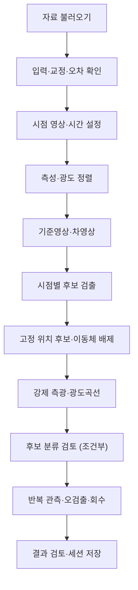

- **자료 불러오기**: 새 영상과 적절한 기준영상, 다중 시점 자료·시간·PSF·오차.
- **입력·교정·오차 확인**: 단위, 영점, WCS, variance, 마스크, 포화, 처리 이력을 확인합니다. 원시 자료는 기구별 교정이 필요합니다.
- **시점 영상·시간 설정**: 노출별 시간계·관측소·필터·WCS·오차를 기록합니다.
- **측성·광도 정렬**: 정렬 오차·seeing·영점과 유효 영역을 검토합니다.
- **기준영상·차영상**: 기준영상이 새 천체 신호를 포함하는지 확인합니다. PSF와 분산을 전파합니다.
- **시점별 후보 검출**: 우주선·결함·회절선·쌍극 잔차를 제거합니다.
- **고정 위치 후보·이동체 배제**: 양/음 잔차, 위치 지속성·이동체·알려진 변광을 검토합니다.
- **강제 측광·광도곡선**: 비검출과 상한, 기준영상 flux·공통 오차를 포함합니다.
- **후보 분류 검토**: 분류기는 훈련 분포·관측 조건을 검증해야 합니다. 후보 등급을 확정 분류로 바꾸지 않습니다.
- **반복 관측·오검출·회수**: 인공 transient 회수와 독립 검토를 수행합니다. 알림·보고 전송은 별도 사용자 작업입니다.
- **결과 검토·세션 저장**: 측정 표·오차·잔차·검증 결과를 확인하고 산출물을 연결한 뒤 연구 세션을 저장합니다. 검토 완료는 과학 검증 통과와 다릅니다.


## 2026-10-13 미연결 단계 실행 연결

영상 기반 8개 목적의 입력 검사에서 물리 픽셀의 유효/결함 수, 평균·산포·범위 및 헤더를 audit.json에 기록한다. 정수 BLANK/BSCALE/BZERO를 처리하며 2D 영상만 받는다. 산포는 sky 잡음이 아니며 교정·마스크·PSF·sky 이력은 별도 검토한다. Desktop은 보고서를 주 분석 패널에 표시하며 파일도 체크포인트에 포함한다. 모든 목적의 마지막 결과 저장 버튼은 기존 산출물 검증·중간 저장을 실제 실행한다.

웹 연결은 선언 데이터의 web_action으로 정의하며 서버가 작업 도구와 소유권을 확인한다.

| 목적/단계 | 웹 연결 |
| --- | --- |
| 초기 구경 측광 | ds10_aper_phot.aper-phot |
| 구상성단 PSF / 산개성단 측광 | ds10_psf_phot.psf-phot: 별 선택·ePSF·이웃 적합·구경 보정 통합 실행 |
| 별 PSF 선택·모형·보정 | 통합 분석기 설정/산출물 검토; 별도 계산으로 중복 실행하지 않음 |
| LSBG 검출 | ds10_lsbg.find: 마스크·sky·검출·측광·구조 추정·선택 통합 실행 |
| LSBG 전후 세부 단계 | 통합 분석기 설정/산출물 검토; 정밀 PSF 포함 모형 검증과 구별 |
| 단일 은하 PSF | ds10_psfstamp.psfstamp: stamp·모형·요약 |
| 검출 설정/분할 검토 | 내장 검출기 설정과 같은 검출 작업의 segmap.fits·목록 |
| 검출 성능 | ds10_counts.counts: 내장 검출기 주입 회수; 검출 설정 일치 필요. PSF 측광/LSBG 전체 선택 완전도를 대신하지 않음 |
| ICL 프로파일 결합 | ds10_workflow.stack: mass-free 공통 kpc 격자·동일 은하단 가중 |

### ICL 프로파일 결합 입력

개별 은하단 측정이 끝난 선형 surface-brightness TSV를 받는다. 열 구분자는 실제 탭이다.
필수 열: CLUSTER_ID, R_KPC, SB, SB_ERR, AREA_KPC2, SB_UNIT, BAND, ICL_DEFINITION, SKY_METHOD, PSF_TARGET.
은하단 ID와 마지막 5개 측정 규약 열은 명시적이어야 하며 규약은 모든 행에서 동일해야 한다.
반경은 음수가 아닌 kpc, SB는 유한 선형 flux(음수 허용), SB_ERR는 음수가 아닌 오차,
AREA_KPC2는 양수인 유효 면적이다. 면적은 기록하되 가중치로 사용하지 않는다.
등급, 혼합 규약, 중복 은하단/반경, 빠진 반경 bin은 거부한다. 보간/질량 재조정은 하지 않는다.
독립 은하단 최소 2개는 실행 조건이며 과학 표본 수 충분성 기준이 아니다.

웹: ICL의 은하단별 프로파일 결합 → 측정된 프로파일 TSV 불러오기 → 이 단계 실행.
UTF-8, 최대 32 MiB이며 계정 소유 캐시에 보관하고 격리된 import 작업으로 목록을 불러온다.
Desktop: TSV를 현재 catalog로 불러온 뒤 같은 단계를 실행한다.
공유 코어 core-dir은 ds10-web/server를 가리킨다.

profile_stack.tsv: 평균 SB, 군집 bootstrap 오차, 별도 측정 오차, 총 유효 면적·은하단 수.
profile_stack.json: 참여 ID, 반경, 측정 규약, 은하단별 유효 면적, seed·재추출 수·전체 반경 공분산.
모든 반경에 같은 은하단 재추출을 적용한다. 관측 군집 산포에 측정 오차를 다시 더하지 않는다.
개별 프로파일의 sky·마스크·PSF·주입 회수·전달함수 및 오차 공분산은 별도 검증해야 한다.
작업 성공은 과학 검증과 구별하며 science_validated는 계속 false다.

남은 전용 분기: 산개성단 membership, AGN host/Fe II 공동 분해, 분광 연속광 adapter,
웹 ICL 개별 sky/프로파일 측정, 시계열 차영상/tracklet, 통합 PSF·LSBG 전체 주입 회수.
이 단계들은 검토/미연결로 남으며 다른 분석기의 성공으로 대체하지 않는다.
Desktop 기존 도구 연결은 유지한다.

결합 작업은 실제 읽은 입력 표를 profile_stack_input.tsv로 보존하고, summary에 입력 SHA-256을 기록한다. 이 표도 체크포인트에 포함한다.

## 2026-10-13 다음 구현: 교정된 1D 분광 준비

Stellar/Galaxy spectrum의 입력 검사와 연속광 단계가 원본 공유 코어로 실행된다.
AGN spectrum에도 동일한 1D 입력 검사 경로를 제공한다. AGN host/Fe II 분해와 구별한다.
웹은 자료 불러오기에서 계정 소유 TSV import 작업을 실행한다. Desktop은 1D TSV를
현재 catalog로 직접 불러오며 영상 프레임이나 파이프라인 popup을 만들지 않는다.
기존 FITS 분광은 별도 추출·교정을 거쳐 이 입력 계약으로 준비해야 한다.

입력은 UTF-8 탭 구분 표이며 필수 열은 WAVE_A, FLUX, FLUX_ERR이다.
선택 MASK는 0=사용, 1=제외다. 한 파일은 교정된 스펙트럼 하나, 최대 32 MiB/250000행이다.
파장은 양수·유한·엄격한 증가 순서인 Angstrom 값이다. flux는 선형이며 FLUX_ERR는
같은 단위의 1-sigma 오차다. 마스크 또는 비유한 flux/오차, 양수가 아닌 오차는 적합에서 제외한다.
입력 검사 도구 설정에서 wave-frame(air/vacuum)과 flux-unit을 명시해야 한다.
단위 선언은 실제 교정이나 기준계 변환을 수행했다는 증거가 아니다.

웹: 분광 목적 선택 → 자료 불러오기(1D TSV) → 입력 검사 도구 열기에서 단위·파장계 지정 →
입력 검사 실행 → 연속광 도구에서 차수·clipping·제외 구간 지정 → 연속광 실행 → 결과 저장.
Desktop: 같은 TSV 불러오기 → ds10core의 spectrum-* 설정 → 입력 검사/연속광 실행 → 결과 저장.
공유 코어 위치는 ds10-web/server이며 Desktop은 별도 프로세스로 호출한다.

연속광은 오차 가중 Chebyshev 다항식(기본 차수 3)을 유한 파장 범위에 적합한다.
제외 구간은 Angstrom의 LOW:HIGH;LOW:HIGH로 지정한다. 방출/흡수선, telluric,
결함 구간을 사용자가 확인해야 한다. 반복 대칭 clipping은 한 번 제외한 표본을 다시 넣지 않는다.
표본 수 부족, rank 결손 또는 심한 ill-conditioning은 실패로 처리한다.
연속광으로 정규화할 때 모형이 양수가 아닌 표본은 빈 값과 플래그로 남긴다.

산출물:
- spectrum_audit.json: 표본 수·유효/적합 가능 수·파장 범위·단위 선언·제외 구간·입력 SHA-256.
- continuum.tsv: 원 flux/오차, 연속광·조건부 모형 오차, 잔차, 정규화 flux·측정 오차, 적합 표본·플래그.
- continuum.json: 계수·계수 공분산·차수·설정·적합 표본 수·reduced chi-square·condition number.
- spectrum_audit_input.tsv / continuum_input.tsv: 각 단계에서 실제 읽은 원본 표. 보고서와 함께 체크포인트에 포함한다.

정규화 측정 오차와 연속광의 조건부 모형 오차는 별도로 보존한다. 적합 픽셀과 모형의
공분산 없이 단순 제곱합하지 않는다. 마스크/차수 선택, 스펙트럼 픽셀 간 상관, 모형 편향은
이 계수 공분산에 포함되지 않는다. 과학 검증 표시는 계속 false다.

현재 1D TSV 경로의 후속 적색편이·선 측정·대기변수·운동학 전용 adapter는 남아 있다.
웹은 해당 버튼을 비활성화하고 지원 범위를 표시한다. Desktop 대상 catalog/FITS 분석기에
스펙트럼 표본 행을 전달하는 것으로 이 기능을 대체하지 않는다.
2D/IFU 추출·sky 교정, 항성종족 흡수 보정 및 AGN/host/Fe II 공동 모형도 후속 작업이다.

Desktop 검증에서 workflow의 창 close 명령과 파일 close 명령의 이름 충돌을 발견했다.
파일 읽기·저장·복원 파이프의 닫기는 명시적인 ::close로 수정했다.


## 2026-10-13 후속 구현: 동정된 고립선·적색편이 후보

Web `ds10_spectrum.lines/redshift`와 Desktop `ds10core.spectrum-lines/spectrum-redshift`를 실제 실행에 연결했습니다. 항성/은하 분광의 선 측정, 은하/AGN 분광의 적색편이 노드는 좌측 상단 기존 분석 단계에서 실행합니다. 별도 workflow popup을 추가하지 않았습니다.

입력은 교정된 1D TSV입니다. `lines`에 `NAME:REST_A;NAME:REST_A`를 입력하고, rest 파장은 입력과 동일한 air/vacuum 관례를 사용합니다. 내장 선 목록 및 자동 선 동정은 없습니다. `redshift`는 초기 추정치이며, `window`는 관측 파장의 반창 폭(Angstrom)입니다. `polarity`는 emission/absorption, `min-snr` 기본값은 5입니다. flux는 반드시 Angstrom당 밀도이어야 합니다. Desktop 설정 이름에는 `spectrum-` 접두사가 붙습니다.

각 고립선을 국소 선형 연속광과 Gaussian으로 오차 가중 공동 적합합니다. 선 적분 flux/오차, 중심/오차, 관측 Gaussian 폭, 전체 5변수 공분산, 적색편이/오차, 잔차와 판정 이유를 기록합니다. 겹치는 창은 공동 블렌드 모형이 필요하므로 거부합니다. 낮은 S/N, 불완전한 창, 부족한 측면 표본, 마스크가 덮는 중심, 성긴 표본, 경계 해, 큰 잔차는 거부하거나 flagged로 표시합니다.

두 개 이상 accepted 선의 적색편이가 오차 안에서 일치할 때만 가중 평균 후보를 보고합니다. 단일선·불일치·검출 실패는 후보가 없습니다. 모든 후보는 사용자가 입력한 선 동정에 조건부이며 `science_validated=false`입니다. 이는 전역 적색편이 검색, 항성 시선속도 보정, 기기 폭 제거, AGN 넓은/좁은선 분해, SFR·블랙홀 질량 추론이 아닙니다. 오차는 독립 표본 가정이며 파장 교정·기준 파장·모형의 체계오차를 포함하지 않습니다. 정의 참고: [SDSS redshift](https://voyages.sdss.org/preflight/light/redshift/).

각 실행은 `{lines|redshift}.json`, `_input.tsv`, `_measurements.tsv`, `_model.tsv`를 산출합니다. 측정표로 활성 스펙트럼을 대체하지 않으므로 후속 연속광/선 작업에 원본 파장·flux·오차·MASK가 유지됩니다. 실행 기록과 산출물은 기존 체크포인트/세션 ZIP 저장·재개에 포함됩니다. 과정 성공은 파일 생성 성공이며 accepted 선 또는 과학 검증 성공을 의미하지 않습니다.

Web의 영상 없는 표 기반 세션 복원도 수정했습니다. 이전에는 진행 상태만 복원하고 활성 catalog를 생략해 다음 단계 실행이 실패했습니다. 이제 저장된 스펙트럼/프로파일 표와 필터·선택을 복원하여 계속 실행할 수 있습니다.

새로고침으로 기록만 재개된 경우에도, catalog가 필요한 다음 단계 실행 전에 해당 세션의 마지막 `catalog.load` 입력을 다시 연결합니다. 파일이 없어 복원할 수 없으면 입력 재연결 메시지를 표시하고 작업 제출을 중단합니다.


## 2026-10-13 후속 구현: 피크 탐색과 적색편이 후보 목록

Web `ds10_spectrum.search`, Desktop `ds10core.spectrum-search`를 항성/은하/AGN 분광의 기존 좌측 상단 순서도에 추가했습니다. 은하/AGN은 기존 redshift 직전, 항성은 science 직전에 탐색합니다. 별도 popup을 만들지 않습니다.

교정된 `WAVE_A/FLUX/FLUX_ERR/MASK`와 같은 air/vacuum 관례의 기준선 목록 `NAME:REST_A;NAME:REST_A`(2–32개)가 필요합니다. 초기 z는 필요하지 않습니다. `z-min/z-max`(기본 0–2), `tolerance`(관측 Angstrom, 기본 3), `baseline`(홀수 21–501 표본, 기본 101), `min-snr`(기본 5), `polarity`, `exclude`를 설정합니다. Desktop에는 `spectrum-` 접두사가 붙습니다. 가까운 별의 blueshift 검색은 z-min을 음수로 지정해야 합니다. 내장 기준선 목록은 없으므로 출처와 파장 관례가 확인된 사용자 목록을 사용합니다.

원본을 보간하거나 마스크를 채우지 않습니다. 사용 가능 연속 구간별로 median baseline을 제거하고, supplied error와 robust scatter 중 큰 값을 사용해 피크 후보를 찾습니다. 단일 표본 스파이크, 경계의 baseline 부족 영역, 짧은 구간을 제외합니다. 구간 내 표본 간격 변화가 20%를 넘으면 오차를 전파한 재표본화가 필요하다는 오류를 표시합니다. 이 탐색은 넓은 AGN 선·블렌드·복잡한 흡수 특징에 대한 템플릿 적합을 대체하지 않습니다.

관측 피크와 기준선의 가능한 대응으로 trial z를 만들고, 다른 피크의 대응을 대조합니다. 한 피크를 여러 기준선에 중복 배정하지 않으며 적어도 두 선이 허용 오차 내 일치해야 합니다. 후보는 선 개수·피크 점수 합·파장 편차로 정렬합니다. 대체 후보도 보존하며 여러 후보가 있으면 `ambiguous`입니다. 최고 점수도 확률·확정 z·오차가 아닙니다. 모든 결과는 `requires_review=true`, `science_validated=false`입니다. 상위 64개 피크/20개 후보 제한에 걸리면 truncation을 명시합니다.

`search.json`, `search_input.tsv`, `search_peaks.tsv`, `search_candidates.tsv`가 저장·재개됩니다. 후보 표의 `suggested_lines`와 `redshift`를 검토해 다음 정밀 선 측정의 `lines/redshift` 설정에 입력합니다. 설정 자동 덮어쓰기나 과학 승인 처리는 하지 않습니다. 겹치는 선은 이후 공동 모형이 필요합니다. 활성 스펙트럼은 그대로 유지합니다. 참고 개념: [SDSS peak-based redshift trials](https://classic.sdss.org/dr5/algorithms/redshift_type.php); 본 구현은 original median detrending/peak matching이며 SDSS 소스·템플릿을 사용하지 않습니다.

흐름: 입력 → 검사/교정 검토 → (항성 연속광 준비) → 선 탐색/대안 검토 → 선택 후보의 정밀 적합 → 잔차/오차 검증 → 저장. AGN host/Fe II 및 넓은/좁은선 공동 분해는 아직 별도 미구현 단계입니다.


## 2026-10-13 후속 구현: 여러 방출선 성분의 공동 적합

AGN `lines` 노드를 Web `ds10_spectrum.joint` / Desktop `ds10core.spectrum-joint`에 연결했습니다. 기존 좌측 상단 단계 안에서 실행하며 별도 pipeline popup은 없습니다. `decompose`의 host/Fe II 템플릿 분해는 아직 미구현입니다.

입력은 교정된 1D TSV와 명시적인 air/vacuum 및 Angstrom당 flux 밀도 단위입니다. `components`는 `NAME:REST_A:SIGMA_MIN_A:SIGMA_MAX_A`를 세미콜론으로 나열(1–8개)합니다. `fit-range`는 관측 파장 `LOW:HIGH`, `redshift`는 초기 z, `shift-limit`은 첫 기준선에서 허용할 관측 중심 이동(Angstrom, 기본 10)입니다. 중심 이동을 공통 z로 전환해 모든 선 중심에 묶습니다. sigma 범위는 관측 Angstrom이며 기기 폭을 포함합니다. 같은 rest 파장의 여러 성분은 폭 범위를 겹치지 않게 지정해 이름 교환을 방지합니다. Desktop 설정 이름은 `spectrum-` 접두사입니다. 예를 들어 합성 기준선 5000 Å의 모형은 `narrow:5000:1:6;broad:5000:8:25`처럼 지정할 수 있습니다. 실제 기준선은 출처와 air/vacuum 관례를 확인해야 합니다.

국소 선형 연속광과 양의 방출 Gaussian 진폭·폭을 동시에 오차 가중 적합합니다. 세 가지 결정적 초기값에서 수렴한 해 중 최소 chi-square를 고릅니다(전역 최적해/후방분포의 보장은 아님). Jacobian 열을 정규화해 퇴화를 검사하고 전체 파라미터 공분산을 산출합니다. 성분 적분 flux 공분산은 전체 모형으로부터 전파하므로 서로 독립이라고 처리하지 않습니다. 모형 조건부 오차는 reduced chi-square가 1을 넘으면 확대합니다.

입력 구간이 완전히 포함되어야 하며 최소 40개 및 파라미터당 4개의 유효 표본, 양끝 10% 구간에 각각 8개의 사용 가능한 표본이 필요합니다. 최대 100,000개 표본을 적합합니다. 퇴화한 성분/수렴 실패는 오류로 중단합니다. 큰 잔차, 경계 해, 낮은 성분 S/N, 성긴 표본, 잘린 날개, 마스크가 덮는 중심은 flagged로 기록합니다. `accepted_model`은 이 수치 점검을 통과했다는 뜻이며 `science_validated=false`, `requires_review=true`입니다. 이름 narrow/broad 자체로 물리적 발생 영역이 입증되지는 않습니다.

`joint.json`(정의·설정·공통 z·파라미터 공분산·성분 flux 공분산·판정), `joint_components.tsv`, `joint_model.tsv`(마스크·사용 여부·연속광·합계·잔차·각 성분), `joint_input.tsv` 원본을 저장합니다. 현재 활성 스펙트럼을 측정표로 대체하지 않으며 기존 Desktop 체크포인트와 Web ZIP 저장·재개에 포함됩니다.

지원 범위는 공통 중심 이동의 방출 Gaussian+국소 연속광입니다. 성분별 속도 오프셋, host/Fe II/항성 흡수 템플릿, 고유 선폭 보정, 소광·광도·블랙홀 질량은 지원하지 않습니다. 좁은/넓은 성분 수 및 연속광 구간을 바꾼 회수 실험과 실관측 대조가 필요합니다. 개념 참고: [SDSS multi-Gaussian/background line fits](https://www.sdss4.org/dr17/algorithms/redshifts/); original 구현이며 SDSS 소스/템플릿을 사용하지 않았습니다.


## 2026-10-13 후속 구현: 사용자 host·Fe II 템플릿 세기 분해

AGN `decompose`를 Web `ds10_spectrum.decompose` / Desktop `ds10core.spectrum-decompose`에 연결했습니다. 앞서 미구현이던 단계가 사용자 준비 템플릿의 고정 모양 세기를 계산합니다. 기존 좌측 상단 순서도 안에서 실행하며 별도 popup은 없습니다.

입력 TSV에 `TEMPLATE_HOST`, `TEMPLATE_FEII`를 추가합니다. 모두 원본 `WAVE_A`의 관측 격자와 동일한 순서/길이, finite/nonnegative 값이어야 합니다. 템플릿은 이미 입력 air/vacuum·적색편이·기기 분해능 및 필요한 폭에 맞춰 준비되어야 합니다. 내장 템플릿을 배포하거나 외부 라이브러리를 다운로드하지 않습니다. `template-note`에는 출처·파장계·격자/적색편이·분해능 준비 근거를 기록해야 합니다. 이름만으로 물리적 host/Fe II 기원을 확인하지 않습니다.

AGN F_lambda 연속광은 `(WAVE_A/pivot)**agn-index`입니다. `agn-index` 기본 -1.5, `pivot` 기본 관측 5000 Å이며 모두 고정 사용자 가정입니다. `fit-range=LOW:HIGH`에서 오차 가중 nonnegative least squares로 AGN/host/Fe II 세 개의 세기를 적합합니다. 해당 템플릿에 포함되지 않은 방출선과 결함은 `exclude`로 제외합니다. 30–100000개의 유효 표본을 요구하고, 템플릿 지지 부족 또는 정규화 설계행렬 퇴화는 오류로 중단합니다.

`decompose.json`, `decompose_input.tsv`, `decomposition.tsv`를 저장합니다. 표에는 원본 FLUX/FLUX_ERR/MASK, template 열, 사용 표본, AGN/HOST/FEII 모형, 합계·조건부 모형 오차·잔차가 있습니다. 원본 flux를 잔차로 대체하지 않으며 활성 입력 스펙트럼도 유지합니다. 계수 공분산은 고정 모양/지수/피벗과 양수 계수 집합에 조건부입니다. 0 경계 계수의 0 공분산은 비검출 상한을 의미하지 않으며 경계와 큰 잔차는 flagged입니다. 모든 결과는 science_validated=false, requires_review=true입니다.

후속 `joint`에서 `continuum-model=templates`를 선택하고 동일한 `agn-index/pivot/template-note` 및 원본 template 열을 사용하면, 세 개의 연속광 세기를 Gaussian 방출선과 함께 재적합합니다. 전체 파라미터 및 성분 flux 공분산에 template 세기와 선의 상관을 포함합니다. 잔차 스펙트럼의 오차를 독립 오차라고 간주하지 않습니다. `linear` 기본 모드는 기존 동작을 유지합니다. 선이 아닌 영역 제외 설정을 분해에서 사용했다면, 공동 선 적합에서는 측정할 선을 제외하지 않도록 별도로 조정해야 합니다.

한계: 템플릿 폭/모양 및 AGN 지수 탐색, host 종족·소광·Balmer continuum, 성분별 속도, 고유 폭/광도·블랙홀 질량은 수행하지 않습니다. 입력 template 준비·대체 template/지수·fit windows의 체계오차를 독립 검증해야 합니다. 개념 참고: [AGN/host/Fe II and lines fitted together](https://arxiv.org/abs/2001.08765). original 구현이며 해당 논문의 소스·템플릿을 사용하지 않습니다.


## 2026-10-13 후속 구현: 공동 적합 선비·log 비 진단

AGN `diagnostic` 노드를 Web `ds10_spectrum.diagnostic` / Desktop `ds10core.spectrum-diagnostic`에 연결했습니다. 선행 `lines`의 완료된 `joint.json`을 입력으로 직접 전달하며 활성 스펙트럼을 바꾸지 않습니다. Web은 해당 workflow에 바인딩된 job/artifact를 전달하고 서버가 소유권을 확인합니다. Desktop은 선행 단계 실행 기록의 파일을 연결하며 체크포인트 복원 파일명 변경도 매핑합니다. 최신 선행 실행이 실패하면 과거 성공 결과로 대체하지 않습니다. workflow 밖에서 Desktop 도구를 쓰는 경우 `spectrum-diagnostic-input`에 joint report JSON을 명시할 수 있습니다.

`ratios`는 `LABEL=NUM+NUM/DEN+DEN`을 세미콜론으로 나열합니다(최대 16개). 이름은 공동 적합에 정의한 성분 이름입니다. 같은 합계 안의 이름 중복은 거부합니다. 예를 들어 `bn=broad/narrow;fraction=broad/broad+narrow`는 넓은/좁은 성분비 및 넓은 성분의 합계 flux 비율입니다. `ratio-min-snr` 기본/최소는 5이며 각 분자·분모 합계의 공분산을 포함한 S/N을 검사합니다. Desktop 이름은 `spectrum-ratios`, `spectrum-ratio-min-snr`입니다.

R=(a·F)/(b·F), gradient=a/(b·F)−b(a·F)/(b·F)^2로 전체 component_flux_covariance를 전파합니다. ratio 및 log10 ratio의 오차와 요청한 여러 비 사이의 covariance도 저장합니다. 같은 성분이 분자와 분모에 공유되면 그 상관을 그대로 반영합니다. ratio error를 독립 flux error만으로 계산하지 않습니다. 참고: [NIST uncertainty propagation with covariance](https://www.nist.gov/pml/nist-technical-note-1297/nist-tn-1297-appendix-law-propagation-uncertainty).

입력은 spectrum-joint JSON(최대 1 MiB)의 finite flux와 대칭·positive semidefinite covariance이며, covariance 대각과 성분 오류의 일치를 검사합니다. 선택한 성분이 flagged 또는 미승인, 비양수 flux/오차, 낮은 합계 S/N인 경우 해당 비는 rejected로 이유를 표시하고 숫자·상한을 만들지 않습니다. 해석은 고정 모형/템플릿과 조건부 1차 Gaussian 전파 범위입니다. 비선형 꼬리·모형 편향·교정의 체계오차는 따로 검증해야 합니다.

`diagnostic.json`, `diagnostic_ratios.tsv`, `diagnostic_joint_input.json` 원본 report를 저장합니다. JSON에는 covariance 순서와 행렬, 선행 report SHA256/원본 스펙트럼 SHA256/단위/공통 z가 있어 어떤 적합을 사용했는지 확인할 수 있습니다. Desktop checkpoint와 Web ZIP 저장·재개에 포함합니다. `accepted_ratio`는 수치 자격이며 `science_validated=false`, `requires_review=true`입니다.

이번 단계는 관측 flux의 성분비 계산입니다. 사용자가 명명한 broad/narrow 등의 물리적 기원, 자동 BPT/AGN 분류, 소광·거리/광도, 비검출 상한 및 블랙홀 질량은 산출하지 않습니다. 적합 설정을 바꿨다면 선행 선 적합부터 다시 실행하고 새 결과로 진단해야 합니다.


## 2026-10-13 통합 구현: BPT 분류·소광·선 광도·블랙홀 질량

앞 절의 미구현 네 항목을 AGN 순서도의 `inference` 단계로 연결했습니다. Web `ds10_spectrum.inference`, Desktop `ds10core.spectrum-inference`이며 선행 `lines`의 `joint.json`을 자동으로 연결합니다. 11개 분석 목적/111개 단계이며, 기존 좌측 상단 순서도와 저장·재개 방식 안에서 진행합니다. Web은 이 단계 안의 설정 JSON 편집기를 사용하고, Desktop은 단계 도구의 `spectrum-inference-config`에 같은 JSON을 넣습니다. Web 파라미터명은 `inference-config`입니다. 활성 입력 스펙트럼은 유지합니다.

네 항목은 각각 설정해야 계산합니다. 기본 `{}`는 모두 `not_configured`입니다. 필요한 선/거리/단위/법칙/기기 분해능 등이 빠지거나 부적절하면 그 항목은 `blocked`와 이유를 남깁니다. 소광 보정 flux 또는 광도를 요구하는 종속 항목도 조건이 없으면 차단합니다. 독립적으로 계산 가능한 항목은 계속합니다. job 성공은 보고서 생성 성공이며 네 과학 결과 모두의 승인과 다릅니다. 모든 결과는 `science_validated=false`, `requires_review=true`입니다.

| 항목 | 명시할 입력 | 산출물 및 조건 |
|---|---|---|
| BPT | `nii/ha/oiii/hb` 성분 이름 배열, `narrow_confirmed=true`, `selection_note` | 관측 좁은선 log([N II]6584/Hα), log([O III]5007/Hβ), 2×2 공분산 및 star_forming_like/composite_like/agn_like/boundary_ambiguous |
| 소광 | `mode=external`의 독립 `ebv/ebv_error`, 또는 `mode=balmer`의 `ha/hb/intrinsic_ratio/intrinsic_ratio_error`; 성분별 `k`와 `law_note` | E(B−V), 오차, 보정 flux와 전체 공분산. k는 사용자가 준비한 고정 Aλ/E(B−V). 음의 Balmer E(B−V)는 보정하지 않음 |
| 선 광도 | 독립 광도거리 `distance_mpc/distance_error_mpc/distance_note`, 양의 `flux_to_cgs/flux_scale_note`, `components`, `dust_corrected` bool | L=4πDL²F, erg/s, 오차와 성분 사이 공분산. aperture 보정 없음 |
| 블랙홀 질량 | `component`, `broad_halpha_confirmed=true`, `calibration=greene_ho_2005_eq6`, `applicability_note`, 양의 `scatter_dex`, `instrument_fwhm_kms/instrument_error_kms/resolution_note` | 넓은 Hα의 고유 FWHM, log10(M/Msun), 측정 오차, 채택한 scatter와 합산 오차. 해당 성분 광도 필수 |

입력 JSON은 최대 32 KiB, 공동 적합 보고서는 최대 1 MiB입니다. 알 수 없는 설정 key는 거부합니다. 선 그룹은 이름 중복 없이 명시하고, 선택한 성분은 accepted/no flags/양의 flux 및 합계 S/N≥5를 만족해야 합니다. BPT 및 Balmer 비는 해당 선의 rest wavelength를 확인합니다. 물리적 좁은선/넓은선 여부는 파장만으로 판정할 수 없어 사용자의 확인과 근거를 요구합니다.

BPT 경계는 [Kauffmann et al. 2003](https://arxiv.org/abs/astro-ph/0304239)와 [Kewley et al. 2001](https://arxiv.org/abs/astro-ph/0106324)를 사용합니다. 두 log 비의 전체 공분산에서 2σ 타원 둘레 128점을 검사하며 영역이 달라지면 `boundary_ambiguous`입니다. 이 검사는 posterior 확률 또는 정확한 신뢰영역 적분이 아닙니다. 곡선 pole 오른쪽을 별형성 영역으로 외삽하지 않습니다. 여기서 자동 분류는 사용자가 식별한 선에 대한 excitation 분류이며 자동 선 식별, 확정 AGN 판정, Seyfert/LINER 세분류는 아닙니다.

Balmer 방식은 E(B−V)=2.5/(kHb−kHa)×log10[(FHa/FHb)/R0]입니다. 두 그룹은 disjoint이고 그룹 안의 k는 같아야 하며 kHb>kHa입니다. R0와 그 오차를 직접 지정해야 합니다. 보정은 Fcorr=F×10^(0.4kE), 계수 10^6 이하입니다. E 추론에 사용한 flux와 보정 flux의 상관을 포함합니다. 좁은선 Balmer 소광을 넓은 Hα에 적용하려면 별도 물리적 근거가 필요합니다. `k`에 성분을 넣는 행위가 그 근거를 제공하지는 않습니다. 법칙 종류·파장계·foreground/internal 적용 및 법칙 자체의 불확실성은 사용자가 확인해야 합니다.

광도거리는 각거리나 comoving distance가 아닙니다([Hogg 1999](https://arxiv.org/abs/astro-ph/9905116)). 단위 문자열로 flux 변환을 추측하지 않습니다. 원본 수치 FLUX가 10^-17 erg/s/cm²/Å일 때 공동 적합 적분 flux의 cgs 변환은 `flux_to_cgs=1e-17`입니다. 사용자 입력 거리의 오차는 적합 파라미터와 독립이라고 가정합니다. 적색편이에서 거리를 자동 추론하거나 cosmology를 기본 채택하지 않습니다.

질량은 [Greene & Ho 2005 식 6](https://arxiv.org/abs/astro-ph/0508335)의 중앙 계수 M=2.0×10^6×(LHα/10^42)^0.55×(FWHMHα/1000)^2.06 Msun입니다. 고정 Gaussian 공동 적합의 관측 폭을 km/s로 바꾸고 Gaussian 기기 폭을 제곱 차로 제거합니다. 관측 폭이 기기 폭과 3σ 이내이거나 고유 폭 S/N<5이면 차단합니다. flux와 폭의 전체 적합 상관, 공통 z, 소광·거리·기기 폭의 독립 보조 오차를 전파합니다. 측정 오차와 사용자가 근거를 갖고 채택한 calibration scatter를 분리해서 보고합니다. 식 계수 오차, virial factor, inclination, 비Gaussian 선 모양, host/Fe II/소광 모형 체계오차까지 포함한 posterior는 아닙니다.

설정 예시는 아래와 같습니다. **모든 값은 합성 검증용이며 관측 데이터의 권장값이나 기본값이 아닙니다.** 각 수치·성분 이름·물리적 근거를 실제 입력에 맞게 바꾸십시오. 특히 scatter=0.4를 해당 논문의 측정오차라고 해석하지 마십시오.

```json
{
  "bpt": {
    "nii": [
      "nii"
    ],
    "ha": [
      "ha"
    ],
    "oiii": [
      "oiii"
    ],
    "hb": [
      "hb"
    ],
    "narrow_confirmed": true,
    "selection_note": "SYNTHETIC EXAMPLE ONLY: matched aperture and narrow-line identities"
  },
  "extinction": {
    "mode": "external",
    "ebv": 0.1,
    "ebv_error": 0.02,
    "k": {
      "broad": 2.5,
      "ha": 2.5
    },
    "law_note": "SYNTHETIC EXAMPLE ONLY: independently justified screen and fixed k"
  },
  "luminosity": {
    "distance_mpc": 100,
    "distance_error_mpc": 2,
    "distance_note": "SYNTHETIC EXAMPLE ONLY: luminosity distance, independently supplied",
    "flux_to_cgs": 1e-17,
    "flux_scale_note": "SYNTHETIC EXAMPLE ONLY: numeric density unit is 1e-17 erg/s/cm2/Angstrom",
    "components": [
      "broad",
      "ha"
    ],
    "dust_corrected": true
  },
  "black_hole": {
    "component": "broad",
    "broad_halpha_confirmed": true,
    "calibration": "greene_ho_2005_eq6",
    "applicability_note": "SYNTHETIC EXAMPLE ONLY: isolated broad Halpha and suitable calibration",
    "scatter_dex": 0.4,
    "instrument_fwhm_kms": 100,
    "instrument_error_kms": 5,
    "resolution_note": "SYNTHETIC EXAMPLE ONLY: Gaussian instrumental FWHM at Halpha"
  }
}
```

`inference.json`, `inference_summary.tsv`, 원본 `inference_joint_input.json`, `inference_config.json`을 저장합니다. 보고서에 선행 적합/스펙트럼 SHA256, 사용한 가정, covariance 순서, 조건부 결과/계산불가 사유를 남깁니다. 네 파일은 Desktop 체크포인트와 Web 산출물 ZIP에 포함하며 복원 후 같은 선행 적합에 다시 연결합니다. 적합 설정 자체를 바꾸면 먼저 `lines`를 재실행해야 합니다.

추가 검증에서 공동 적합 운동학의 finite/기준파장/shift–redshift 일치를 검사하도록 보완했습니다. 현재 최종 134개 테스트가 통과했으며 상세 범위와 한계는 [추가 검증 보고서](validation_spectrum_2026-10-13.md)에 있습니다.
