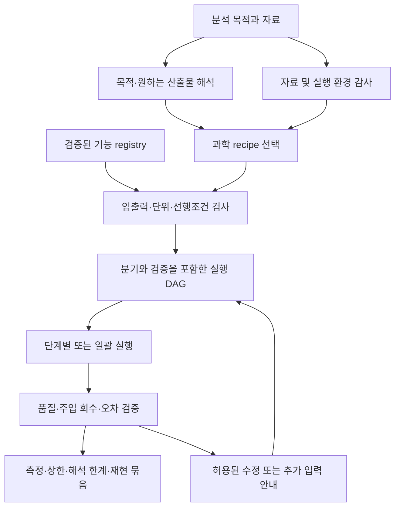

# 분석 목적 기반 파이프라인 설계·실행 도구

작성: 2026-10-13 (Asia/Seoul)
상태: 사용자 요구사항을 반영한 제품 설계 / 자동 설계 엔진 미구현
임시 명칭: Astrispex — 기존 Astrafex/OGFinder 연결을 우선 설계하며 제품명·배포
형태는 미확정이다.

같은 날 구현 갱신: Desktop과 Web에 11개 분야의 선언적 순서도 선택, 기존 도구
연결, 단계별 검토·메모, 중간 산출물 저장과 복원을 추가했다.
[현재 사용법과 분야별 순서도](science_pipelines.md)를 참고한다. 아래의 자연어
목적 해석·입력 감사 기반 DAG 자동 생성과 전체 과학 검증은 후속 설계다.

## 1. 사용자 경험과 제품 목표

사용자가 “구상성단의 별 측광”, “LSBG 탐색”, “ICL과 위성은하 외곽구조의 관계”
처럼 분석 목적을 말하고 자료를 지정하면, 도구가 자료를 확인하고 필요한 처리·
검증 단계를 구성한다. 사용자는 제시된 흐름을 따라가거나 이미 정한 실행 범위에서
일괄 실행하여 결과·오차·품질·재현 기록을 얻는다.

목적만으로 관측 자료에 없는 정보를 만들어낼 수는 없다. 최종 산출물은 요청한
측정, 검증된 상한, 또는 자료 부족으로 판정할 수 없는 범위와 필요한 후속 입력을
명시한 보고서다. 수치 파일 생성과 과학적으로 검증된 결과를 구별한다.

기본 흐름은 **목적 입력 → 자료 확인 → 실행 가능한 계획 생성 → 단계별/일괄
실행 → 검증 → 결과 묶음**이다. 최초 계획에서 예상 산출물·필수 입력·자원과
자동으로 처리할 범위를 제시한다. 실행 요청 이후 가역적인 통상 단계마다
승인을 다시 묻지 않는다. 과학적 목적이나 필요한 입력이 모호할 때만 최소한의
질문을 하고, 답에 영향받지 않는 감사·준비는 계속한다.

## 2. 설계 원칙

- 자연어 해석은 목적·측정량·제약을 구조화한다. 실제 실행은 등록된 도구와
  버전이 있는 과학 recipe, 타입·단위 검사로 확정한다.
- 메뉴 이름 연결이 아니라 **최종 산출물에서 필요한 입력을 역으로 추적**한다.
  자료의 PSF·혼잡도·밴드·교정 수준에 따라 검증 가능한 분기를 선택한다.
- 기존 코드가 없거나 headless 실행이 검증되지 않은 단계는 `unavailable` 또는
  `manual`로 표시한다. 존재하지 않는 명령을 생성하거나 자동 구현한 것으로 취급하지 않는다.
- 예비 측정으로 매개변수를 조정하고 본 분석 전에 고정한다. 유의한 결과가
  나올 때까지 기준을 바꾸는 자동 최적화는 하지 않는다.
- 중간 수정은 영향받는 후속 단계만 무효화한다. 이미 완료한 무관한 처리는 재사용한다.
- 사용자에게는 각 단계의 목적·현재 상태·결과를 보여주고, 내부 코드·해시는
  재현 상세 보기로 제공한다.

## 3. 시스템 구조

재계획 횟수·자원·매개변수 탐색 범위를 제한한다. 설정으로 해결되지 않는
결손 자료는 임의 대체하지 않으며 해당 분기만 `needs_input` 상태로 둔다.

| 계층 | 책임 | 제안 위치 |
|---|---|---|
| 목적 해석 | target, measurement, desired outputs, constraints 추출 | `ogfkit/workflows/intent.py` |
| 자료 감사 | 제품/밴드/단위/영점/PSF/마스크/환경 상태 판정 | `ogfkit/workflows/audit.py` |
| 기능 목록 | 기존 plugin 실행 adapter와 과학 입출력 계약 | `ogfkit/workflows/registry.py` |
| 과학 recipe | 목적별 검증된 단계·조건·필수 결과 정의 | `workflows/recipes/` |
| 계획 생성 | 산출물 의존성 해소, 분기 선택, 이유 기록 | `ogfkit/workflows/planner.py` |
| 계획 검사 | 타입·단위·밴드·좌표·중복 교정·순환 검사 | `ogfkit/workflows/compiler.py` |
| 실행·재개 | 상태, 입력 fingerprint, 자원, 부분 실패 | `ogfkit/workflows/runner.py` |
| 결과·UI | 작업 카드, 영상·표·도표, 재현 보고 | `plugins/workflow_designer/` |

이 표의 경로는 제안이며 아직 구현하지 않았다. 규칙 기반 template 선택만으로도
실행 계획을 만들 수 있게 하여 자연어 모델 없이도 동일 계획을 재현한다. 모델
출력은 선언적 계획으로 검사하며 임의 셸 코드를 실행하지 않는다. argv 배열로
등록된 adapter를 호출하고 데이터의 텍스트를 실행 지시로 해석하지 않는다.

## 4. 계획과 기능의 계약

`Intent`는 대상, 요청 측정량, 최소 최종 산출물, 입력 참조, 정확도·자원 제약,
사용자가 확정한 조건, 미확정 항목을 갖는다. “별 측광”에서 나이·금속도 측정을
자동으로 추가하지 않는다. “LSBG”가 탐색인지 알려진 대상 측정인지는 자료와
선택 객체로 추론하되 불확실하면 한 번 확인한다.

`Capability`는 아래를 기록한다.

| 계약 | 내용 |
|---|---|
| 신원 | stable ID, version, plugin/step 또는 adapter, 구현·검증 상태 |
| 입력·출력 | artifact type, 필수 열, 단위, 좌표계, 밴드, 교정 상태 |
| 적용 조건 | raw/calibrated 구분, 점광원/확장광원, 혼잡도·PSF·해상도 조건 |
| 매개변수 | 허용 범위, 단위, 기본값 근거, 예비 분석에서 정할 값 |
| 검증 | 성공 파일 계약, 수치 품질 기준, 과학 적용 범위 |
| 실행 | CPU/GPU·메모리·예상 I/O, headless/manual, 중단·재개 지원 |
| 효과 | 생성 산출물, 외부 네트워크/쓰기 여부, 입력 보존 규칙 |

기존 `plugin.json`은 UI와 CLI 연결의 기반이다. 추가 과학 계약은 우선 별도
sidecar로 두어 기존 schema 1 loader를 깨지 않는다. `AUTO` 기록 가능과
과학적으로 자동 실행 가능을 같다고 취급하지 않는다. 기구별 raw 교정 adapter가
없으면 raw FITS를 교정된 영상처럼 다음 단계로 넘기지 않는다.

`PipelinePlan`은 버전, 입력 및 intent, recipe 버전, 결정과 근거, 노드·의존성·
분기, 필수 산출물, 자원 상한, 검증 기준을 갖는다. 노드는 실행 도구, 입력
artifact, 출력 계약, 매개변수와 근거, 상태 및 실패 처리를 갖는다. 입력 artifact는
경로만이 아니라 밴드·단위·교정 계보가 검증되어야 연결할 수 있다.

예를 들어 PSF 측광 노드는 같은 영상/좌표에 해당하는 PSF가 없으면 앞에 PSF
구성 단계를 넣는다. 영점이 없으면 instrumental magnitude는 만들 수 있지만
보정 등급 완료로 표시하지 않는다. 이미 sky subtraction을 한 입력에는 같은
처리를 조용히 중복 적용하지 않는다.

## 5. 예시 A — 구상성단의 별 측광

기본 최종 산출물은 별별 위치·flux·등급·오차·품질 표와 잔차 영상이다.
두 개 이상의 유효 밴드가 있으면 CMD를 구성할 수 있고, 멤버십 근거는 별도로
연결한다. 시야의 모든 검출을 구상성단 멤버로 확정하지 않는다.

1. FITS 제품·밴드·gain/read noise·단위·포화·WCS·교정 출처를 확인한다.
   이미 교정된 제품은 교정 정보를 재사용하고, raw 자료는 맞는 기구 recipe가 필요하다.
2. 예비 검출로 PSF와 혼잡도·포화를 평가한다. 혼잡하면 동시/반복 PSF 측광을
   선택하고, 충분히 분리된 별의 구경 측광을 진단·구경 보정에 사용한다.
3. 적합한 PSF 별을 골라 이웃 영향을 줄이고, 공간 변화가 검증되는 범위의 PSF를
   구성한다. 영상에 적합한 PSF 기준이 없으면 검증된 외부 PSF 또는 추가 입력이 필요하다.
4. 별 검출 → 그룹 적합 → 이웃 제거 → 잔차 재검출을 정해진 수렴·반복 한도까지
   수행한다. DAOPHOT 관련 기존 기능의 실제 구현 범위와 입력 조건을 확인해 연결한다.
5. 구경 보정·영점·필요한 색항을 적용하고 오류를 전파한다. 다중 노출·밴드 자료는
   대응과 측광계를 검증한 뒤 결합하며 PSF 측정이 가능한 노출별 처리를 우선 검토한다.
6. 인공별을 기존 혼잡도를 크게 바꾸지 않는 소량씩 넣어 위치·등급·색별 회수율,
   blending 편향·오차를 평가한다. 기본 검출 callback만이 아니라 실제 사용한
   검출부터 최종 품질 컷까지 반복해야 완전도 검증이 된다.
7. 보정 측광 표, 품질·완전도 표, 잔차 영상, 가능한 경우 CMD, 방법·계보를 출력한다.

단일 밴드이면 CMD 분기는 비활성으로 남기며 측광 결과는 계속 제공한다.
중심부가 분해되지 않는 경우 해당 범위의 완전도 한계를 보고하고 개별 별
측광이 가능하다고 약속하지 않는다. 나이·질량함수·거리 추론은 사용자가 추가로
요청하고 해당 입력·모형이 있을 때 붙이는 확장 recipe다.

## 6. 예시 B — LSBG 탐색·측정

기본 최종 산출물은 후보 목록, 표면밝기·각크기·색(가능한 밴드)·오차, 영상
진단, 검출/선택 완전도다. 거리가 없으면 물리 크기와 절대광도는 미정으로 둔다.

1. 표면밝기 교정·pixel scale·PSF·sky 처리 이력·깊이·마스크를 감사한다.
2. 밝은 별의 날개와 영상 결함을 식별하고 확장광원을 과도하게 지우지 않는
   마스크 및 배경 모형을 설계한다. 배경 제거 전에 확장 신호 보존 실험을 계획한다.
3. 크기 범위에 맞는 검출을 수행한다. 스무딩·다중 스케일 영상은 검출용으로
   쓰고 측광은 원본과 명시적 PSF 모형을 사용한다.
4. 이웃·배경과 함께 표면밝기 및 형태를 측정하고, Sérsic 모형의 적합 실패·
   비대칭 잔차·모형 의존성을 기록한다. 모든 후보에 좋은 Sérsic 적합을 강요하지 않는다.
5. 표면밝기·각크기·품질 컷을 적용한다. 학습 분류기를 쓸 경우 훈련·검증
   영역을 확인하고 점수를 후보의 물리적 정체 확정으로 취급하지 않는다.
6. 크기·밝기·형태·배경 위치를 바꾼 인공은하를 넣고 실제 검출·측광·선택까지
   회수하여 완전도·편향을 측정한다. 회수율만으로 순도를 계산하지 않으며,
   독립 라벨/대조 표본 등 오검출 평가 근거가 없으면 순도는 미확인으로 둔다.
7. 후보 카탈로그, 컷아웃·모형·잔차, 선택함수와 적용 범위, 방법·계보를 출력한다.

알려진 LSBG의 측정 요청이면 무관한 전 시야 탐색 단계를 생략하고 대상 주변
배경·PSF·구조 측정과 편향 검증을 강화한다. 관측 데이터에 남은 은하의 유효
크기 범위를 넘어서는 복원이나 상류 sky 손실의 회복은 자동으로 가정하지 않는다.

## 7. 예시 C — ICL과 위성은하 외곽구조

이 목적은 단일 선형 체인이 아니라 은하단 중심 확산광과 위성 중심 별빛의
두 갈래, 공동 검증 및 공분산을 갖는 recipe다. 설계는
[과학 연구계획](../analysis/icl_wgl_membership/science_research_plan.md)과
[공동 분석 도구 설계](../analysis/icl_wgl_membership/research_software_design.md)에 있다.
기존 800개 후보 수집을 재사용하며 추가 분석 엔진은 미구현으로 표시한다.
이 recipe를 일반 엔진의 분기·집합 평균·공동 오차 처리 사례로 사용한다.

## 8. UI와 실행 제어

화면 상단에는 “무엇을 측정할까요?” 입력과 자료 선택을 둔다. 생성된 계획은
각 단계에 **목적 / 필요한 자료 / 실행 상태 / 결과 보기**를 표시한다. 분기에는
선택 이유를 적고 자료 부족 단계에는 해결에 필요한 입력을 구체적으로 표시한다.
“다음 단계”, “가능한 단계 실행”, “중단 후 재개”, “결과 묶음 저장”을 제공한다.

노드 상태는 `planned`, `ready`, `running`, `completed`, `failed`, `needs_input`,
`interrupted`, `skipped`다. skipped는 선택 분기에만 허용하고 이유를 남긴다.
실행 완료와 과학 품질 상태는 별도로 표시한다. 필요한 산출물이 빠진 채
전체 성공을 표시하지 않는다. 실패해도 유효한 독립 분기는 계속할 수 있다.

사람의 판단이 필요한 PSF 별/오검출 후보/마스크 검토는 같은 DAG의 명시적인
검토 노드로 둔다. 수동 결과도 버전 있는 artifact로 저장하여 다음 단계가
사용한다. 이미 승인된 매개변수 범위 내 자동 조정은 반복 확인하지 않는다.

계획 수정 시 비교 화면에 새 단계·삭제 단계·다시 계산할 결과를 보여준다.
과학 검증 실패를 숨기기 위해 gate를 완화하지 않고, 허용된 수정을 다 쓰면
최종 보고서에 한계와 필요한 자료를 남긴다.

## 9. 기존 구현과 차이

2026-10-13에 확인한 `docs/plugins.md`와 plugin manifest에 따르면 CLI/headless
단계, session recorder, `batch` recipe 실행·재개, `repro` 결과 묶음이 이미 있다.
`daophot`, `photometry`, `completeness`, `lsbg`는 개별 기능의 재사용 후보다.
이 확인은 manifest/문서 감사이며 각 기능을 새 자료에서 실행 검증한 것은 아니다.

현재 부족한 핵심은 **목적→과학 recipe 선택, 풍부한 입출력 계약, 자료 의존 분기,
검증 결과에 따른 제한된 재계획, 최종 과학 산출물 충족 검사**다. 기존 batch는
다중 시야 실행에 재사용하고, 연구 수준 DAG·집합 결합·공동 검증은 상위 실행기가
관리한다. GUI proc만 있는 단계는 headless adapter를 검증하기 전 자동 노드로
노출하지 않는다. 큰 repro archive 생성도 로그인 노드에서 수행하지 않는다.

## 10. 개발 순서와 수용 기준

| 단계 | 납품 범위 | 완료 기준 |
|---|---|---|
| P0 | Intent/Artifact/Capability/Plan schema와 registry | 존재하지 않는 도구·잘못된 단위·미충족 입력·순환을 실행 전에 거절 |
| P1 | 별 측광·LSBG recipe와 계획 출력 | 같은 목적·자료·버전은 동일 DAG, 분기 이유·최종 산출물 표시 |
| P2 | 기존 batch/CLI adapter와 재개 | 중단·오류·설정 변경에서 올바른 단계만 재실행, 입력 보존 |
| P3 | 각 recipe의 과학 검증·결과 묶음 | 이름 있는 시험 자료에서 오차·완전도·실패 범위까지 재현 |
| P4 | 자연어 입력·단계 안내 UI | UI와 CLI 계획·결과 동일, 최소 질문으로 진행 |
| P5 | ICL–위성 공동 recipe | 집합 가중·두 갈래·주입/회수·공동 공분산 계약 통과 |

검사 사례에는 두 밴드/단일 밴드, 혼잡/비혼잡, 영점·PSF 누락, raw/교정 영상,
확장광원 배경 손실, 설치되지 않은 도구, 중단·재개, 완전도 미검증 결과를
최종 완료로 잘못 표시하는 경우를 포함한다. 자동 자연어 해석 평가는 여러
표현이 같은 과학 목적과 DAG로 연결되는지, 필수 가정이 달라질 때 질문하는지
검사한다. 생성 문장이 그럴듯한 것만으로 planner 성공을 판정하지 않는다.

CPU 검증·분석은 현 사용자 환경에서 `lageunha`로 라우팅하고 GPU가 필요한
등록 기능만 별도 자원 규칙을 따른다. 큰 다운로드·새 외부 전송은 기존 허용
범위를 따르며 분석 계획에 인증정보를 저장하지 않는다.

## 11. 장기 유지

이 문서는 프로젝트의 범용 연구 파이프라인 요구사항 기준이다. ICL–위성 연구는
장기 과학 주제로 유지하고 본 도구의 recipe 중 하나로 연결한다. 제품 설계의
변경은 날짜와 근거를 기록하고, 과학 recipe 버전과 코드 버전을 각각 관리한다.
이번 작업은 설계 문서 등록이며 자동 planner·신규 UI를 구현한 상태는 아니다.
